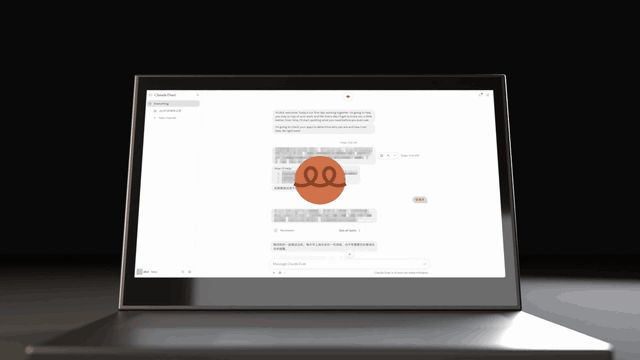

<a href="docs/claude-duet-opening.mp4"></a>

第一片成片（15 秒，点图看 1080p MP4）：用本技能和 [examples/claude-duet-opening](skills/blender-3d-animation/examples/claude-duet-opening/) 的脚本渲出，Claude Code 全程写脚本、审片、渲染。

# blender-3d-animation-skill

给 Claude Code（以及 Cursor 等能读 SKILL.md 的 agent）用的技能：在本机用 Blender Python 脚本做短 3D 动画镜头，按固定的检查流程交付。

流程：认素材 → 隐私打码 → 贴图检查 → 接触表 → 逐帧越界检查 + 18 张静帧审片取色 → 按帧号修 → 全片渲染（可续渲）+ MP4。

## 目录

```
skills/blender-3d-animation/
├── SKILL.md                    流程（agent 读这个）
├── scripts/
│   ├── prep_screens.py         截图打码 + 裁切 → 屏幕贴图
│   ├── sample_color.py         渲染帧取色，对比目标 HEX
│   ├── sheet.sh                PNG / 视频抽帧拼审片总览图
│   ├── bounds_check.py         逐帧投影：出画、出 9:16 区、标题出屏幕
│   └── render_full.sh          后台全片渲染 + 防睡眠 + 断点续渲 + 合成 H.264
├── references/
│   ├── pitfalls.md             踩过的坑（Blender 5 API、色彩、光照、取色、耗时）
│   └── brief-template.md       需求模板
└── examples/
    └── claude-duet-opening/    第一片：15 秒毛毡圆片开头，完整可跑
FOLLOWUPS.md                    待讨论的改进
CHANGELOG.md                    每一版改了什么
```

## 安装（本机）

```bash
ln -s "$PWD/skills/blender-3d-animation" ~/.claude/skills/blender-3d-animation
```

需要：Blender 5.x（`/Applications/Blender.app`）、ffmpeg、Python 3（只用标准库）。Apple Silicon 上走 Metal GPU。

## 怎么维护

每做完一片：

1. 新踩的坑写进 `references/pitfalls.md`（现象 → 原因 → 做法，注明哪一期）。
2. 没解决、值得改的写进 `FOLLOWUPS.md`，讨论后决定做不做。
3. 流程有变就改 `SKILL.md`，在 `CHANGELOG.md` 记一行。
4. 有代表性的镜头放进 `examples/<期名>/`：脚本 + 需求原文，不放素材和截图。

素材、截图、渲染结果都不进仓库（`.gitignore` 已排除），只放脚本和文字。
